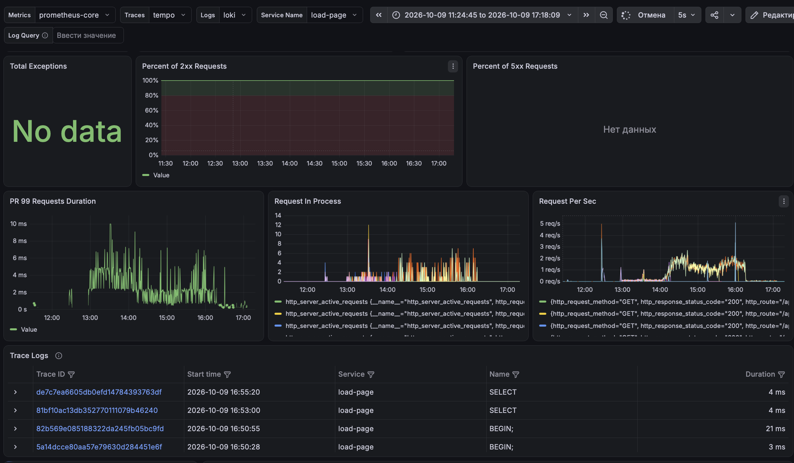
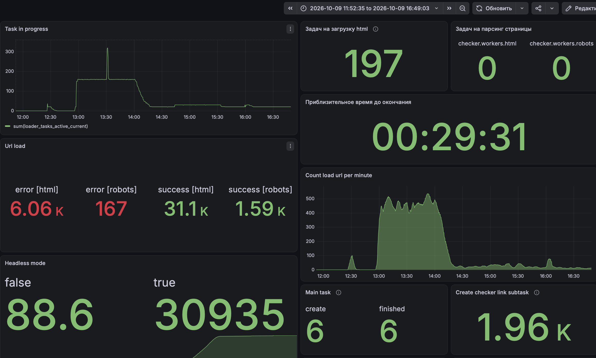

# Panda Demo


## Repository secrets

Добавить в Settings → Secrets and variables → Actions → Repository secrets:

| Secret | Значение |
| --- | --- |
| `VPS_HOST` | IP или DNS-имя VPS |
| `VPS_USER` | SSH-пользователь с доступом к Docker |
| `VPS_SSH_KEY` | Приватный SSH-ключ без passphrase, целиком с заголовком и окончанием |
| `VPS_KNOWN_HOSTS` | Проверенная запись SSH host key сервера из `known_hosts`; для нестандартного порта адрес имеет вид `[host]:port` |
| `VPS_PORT` | SSH-порт; необязательно, по умолчанию `22` |
| `VPS_PATH` | Абсолютный путь к уже клонированному репозиторию приложения на VPS, например `/opt/panda-demo` |
| `HELM_REPO_URL` | HTTPS URL другого GitHub-репозитория, например `https://github.com/owner/helm-repo.git` |
| `HELM_REPO_TOKEN` | Fine-grained PAT с доступом к Helm-репозиторию и `Contents: Read and write` |
| `SERVICE` | Имя каталога сервиса в Helm-репозитории, например `panda-demo` |

Для публикации и скачивания образа workflow использует автоматически созданный
`GITHUB_TOKEN`: вручную добавлять его в secrets не нужно. Публикации дано
`packages: write`, VPS-деплою — `packages: read`. Пакет GHCR должен разрешать
этому репозиторию доступ; label `org.opencontainers.image.source` связывает
новый пакет с исходным репозиторием.

`HELM_REPO_TOKEN` нужен именно для другого репозитория. Его владелец должен
иметь право пушить в `main`, включая разрешения branch protection, если они
настроены. Если образ и обе переменные уже актуальны, шаг завершается без
нового коммита. Ошибки clone, commit или push завершают workflow с ошибкой.

Переменные `GIT_SHORT_HASH` и `GIT_TAG` добавляются, если их не было; остальные
переменные окружения сохраняются.

Workflow определяет `GIT_TAG` только для тега, указывающего на собираемый коммит
(`git describe --tags --exact-match`). Тег должен быть запушен в GitHub до
сборки. Если тег запушен позже коммита, запустите workflow вручную через
`workflow_dispatch` для этой ветки: push самого тега сейчас не запускает сборку.
Тег передаётся в окружение образа, VPS и Kubernetes; имя образа в GHCR использует
короткий хеш коммита, например `ghcr.io/xaker00ua/panda-demo:c6c727a`.

## Подготовка VPS

На сервере нужны Bash, Git, Docker Engine и Docker Compose v2. Образ собирается
на Linux runner для `linux/amd64`; VPS должен поддерживать эту архитектуру.
Перед первым деплоем:

1. Клонировать репозиторий приложения в `VPS_PATH`.
2. Настроить для SSH-пользователя доступ к `origin`, чтобы `git fetch` и
   `git pull` работали без ввода пароля. Для приватного репозитория можно
   установить отдельный read-only deploy key на VPS.
3. Добавить публичную часть `VPS_SSH_KEY` в `authorized_keys` этого пользователя.
4. Проверить доступ пользователя к Docker без `sudo` и записать проверенный
   host key сервера в `VPS_KNOWN_HOSTS`.
5. Создать ssl сертификаты для домена `panda.wotbstats.xyz` и положить `/` на VPS.

Compose получает `APP_IMAGE` и запускает скачанный образ без локальной сборки.
Сначала выполняется `pull`, чтобы ошибка скачивания не останавливала работающее
приложение. После `down` будет короткий перерыв до завершения `up`.
Учётные данные GHCR хранятся во временном Docker config и удаляются после деплоя.

Для ручного повторного запуска уже скачанного образа на VPS:

Пример `.env.deploy`
```bash
APP_IMAGE=ghcr.io/xaker00ua/panda-demo:c025041
GIT_SHORT_HASH=c025041
GIT_TAG=v0.1
```
```bash
docker compose --env-file .env.deploy -f docker-compose.local.yaml up -d --no-build
```

## Локальный запуск

```bash
uv sync --locked --dev
uv run ruff format
uv run ruff check
GIT_SHORT_HASH=local uv run pytest
docker compose -f docker-compose.local.yaml up --build -d
```
или если установлен [task](https://taskfile.dev/docs/)
```bash
task
```
## Monitoring 
Я использую [Prometheus](https://prometheus.io/), [Grafana](https://grafana.com/), [Loki](https://grafana.com/docs/loki/latest/), [Tempo](https://grafana.com/docs/tempo/latest/),
[Opentelemetry](https://opentelemetry.io/)
Opentelemetry поддерживается на многих языках Python, Java, Go, Net, PHP, JavaScript. 
На многих есть автоинструментация, которая позволяет екпортировать логи трейсы метрики без изменения кода приложения 


## Terraform
З Тераформом не работал вместо него использую Ansible 
